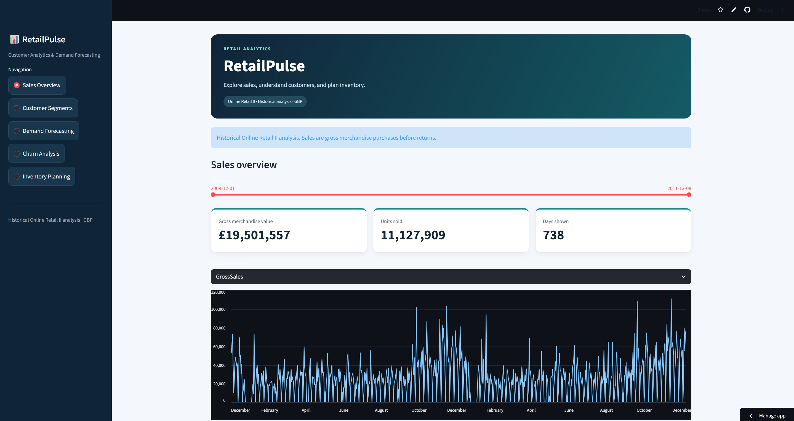

<div align="center">

# 🛍️ RetailPulse

### Customer Analytics & Demand Forecasting Platform

<p>
  
  
  
  
</p>

**📊 Customer Segmentation · 📈 Sales Forecasting · 🎯 Inactivity Prediction · 📦 Inventory Planning**

[**🚀 Explore Live Dashboard**](https://retailpulse-nandini57.streamlit.app/) · [**💻 View Repository**](https://github.com/rawlonandini57/RetailPulse)

</div>

---

## 🌐 Live Demo

- **Streamlit dashboard:** [retailpulse-nandini57.streamlit.app](https://retailpulse-nandini57.streamlit.app/)
- **GitHub repository:** [rawlonandini57/RetailPulse](https://github.com/rawlonandini57/RetailPulse)

## 📖 Project Overview

RetailPulse is a retail analytics portfolio project that turns historical transaction data into sales insights, customer segments, purchase-inactivity rankings, and inventory planning scenarios.

Using the **Online Retail II** dataset, the project combines data preparation, machine learning, forecast evaluation, and an interactive Streamlit dashboard.

The platform helps users explore:

- **Customer behavior:** understand purchase recency, frequency, and spend.
- **Sales patterns:** compare historical trends and forecast baselines.
- **Customer inactivity:** rank customers by their likelihood of making no purchase during a defined future period.
- **Inventory scenarios:** estimate replenishment quantities using explicit stock and lead-time assumptions.

> **Current scope:** A deployed dashboard with baseline analytics. Results refer to historical periods; advanced modeling and production MLOps remain planned. Business improvements have not yet been measured.

---

## ✨ Key Features

| Dashboard page | Capabilities |
|---|---|
| **Sales Overview** | Filter dates and explore gross merchandise purchase value, units sold, and invoice counts. |
| **Customer Segments** | Compare two provisional RFM-based groups and inspect customer records by segment. |
| **Demand Forecasting** | View a 30-day sales-unit forecast, earlier validation results, and downloadable forecasts. |
| **Churn Analysis** | Inspect historical 90-day inactivity rankings, model metrics, and the highest-risk 20% of customers. |
| **Inventory Planning** | Enter stock inputs, calculate replenishment scenarios, review product forecast validation, and download results. |

## 🏠 Home Dashboard



Explore historical gross merchandise purchase value, units sold, and daily sales trends using the date-range filter.

| Metric | Displayed value |
|---|---:|
| Date range | 1 December 2009 – 8 December 2011 |
| Gross merchandise value | £19,501,557 |
| Units sold | 11,127,909 |
| Days shown | 738 |


*Historical Online Retail II analysis. Monetary values are in GBP and represent gross merchandise purchases before returns.*

<!-- Keep screenshots/sales_overview.png in the repository root's screenshots folder so the relative image link renders on GitHub. -->

## 🛠️ Technology Stack

| Area | Tools used |
|---|---|
| Data preparation | Python, pandas, NumPy, openpyxl |
| Exploration | Jupyter Notebook, Matplotlib |
| Customer modeling | scikit-learn: K-Means and logistic regression |
| Forecast evaluation | Weekday-based baselines and Prophet |
| Dashboard | Streamlit |
| Source hosting and deployment | GitHub and Streamlit Community Cloud |

The dashboard loads prepared CSV outputs. It does **not** retrain models during page visits. `requirements.txt` covers dashboard dependencies; the notebook training environment requires separate dependencies.

## 🗂️ Dataset & Data Preparation

The source workbook contains **1,067,371 transaction lines** across two worksheets, spanning December 2009 to December 2011. Its fields include invoice, stock code, description, quantity, timestamp, price, customer ID, and country.

Preparation includes:

1. Reconcile overlapping worksheet records by matching identical occurrences across sheets.
2. Separate returns/cancellations and records requiring review from eligible purchases.
3. Exclude non-merchandise charges, adjustments, gift vouchers, test entries, manual entries, and samples from merchandise analysis.
4. Retain eligible purchases without customer IDs for aggregate sales analysis; exclude them from customer-level modeling.
5. Aggregate daily sales and construct historical customer features.

| Cleaning result | Count |
|---|---:|
| Cross-sheet repeated copies removed | 22,523 |
| Transactions remaining after overlap reconciliation | 1,044,848 |
| Eligible purchase rows before merchandise exclusions | 1,019,654 |
| Return/cancellation rows | 22,558 |
| Other rows requiring review | 2,636 |

Potential duplicate lines **within worksheets were retained** and documented. All monetary sales measures are gross purchases before returns, not net revenue or profit.

## 📊 Modeling & Results

### Customer segmentation

Recency, frequency, and monetary features are calculated over the final 365-day observation window, transformed with `log1p`, standardized, and clustered with K-Means.

| Provisional segment | Customers | Median recency (days) | Median invoices | Median gross spend (GBP) |
|---|---:|---:|---:|---:|
| Recent, higher-value customers | 1,654 | 17 | 5 | 1,975.62 |
| Less-recent, lower-frequency customers | 2,607 | 93 | 1 | 352.70 |

The first group accounts for about **85.02% of gross merchandise spend** in this customer window. These groups can inform loyalty and reactivation hypotheses; their campaign impact has not been measured. Cluster labels do not establish churn, and the two-cluster selection remains provisional.

### Demand forecasting

Models are compared over three earlier 30-day validation windows, using only information available before each window.

| Model | Mean MAE (units/day) | Mean RMSE (units/day) | Mean window WAPE | Worst window WAPE |
|---|---:|---:|---:|---:|
| **Four-week weekday average** | **6,339.83** | 8,497.11 | **35.16%** | **40.66%** |
| Prophet | 6,433.34 | **7,773.96** | 36.12% | 45.70% |
| Repeating last week | 7,100.71 | 10,437.00 | 38.88% | 41.75% |

The four-week weekday average is the provisional selection based on mean WAPE. Prophet performs better on mean RMSE, illustrating the importance of choosing evaluation criteria explicitly.

- Mean window WAPE weights each validation window equally; it is not pooled WAPE.
- WAPE is not MAPE or an accuracy percentage.
- The latest 30-day evaluation period was inspected during development and is no longer an untouched final test.
- The exported forecast covers **9 December 2011 to 7 January 2012**.
- There is no explicit Christmas or New Year adjustment.

### Customer inactivity prediction

The target is **no merchandise purchase in the next 90 days**, using purchase features from the preceding 180 days. This is an operational inactivity definition, not proof of permanent departure.

Training uses a **1 March 2011** snapshot; later evaluation uses **1 September 2011**. Training outcomes finish before the evaluation prediction date. Customer identifiers and snapshot dates are excluded from model inputs.

| Method | ROC-AUC | Average precision | Precision in top 20% | Lift in top 20% |
|---|---:|---:|---:|---:|
| **Logistic regression** | **0.731** | **0.590** | **0.632** | **1.607** |
| Recency benchmark | 0.657 | 0.543 | 0.612 | 1.557 |

At a fixed threshold of 0.50, logistic regression achieved **precision 0.513**, **recall 0.858**, and **F1 0.642**. High recall comes with substantial false positives. Risk scores require calibration and further temporal evaluation before operational use.

### Inventory scenarios

The prototype selects up to 20 products using training-period sales and evaluates product-level weekday-average forecasts.

| Assumption | Value |
|---|---|
| Supplier lead time | 7 days |
| Inventory review interval | 7 days |
| Planning buffer | 20% of forecast sales over the 14-day protection period |
| Incoming orders | Assumed to arrive within the planning period |

**Inventory position = stock-on-hand + on-order − backorders.**

Suggested orders equal the non-negative difference between the target inventory position and current inventory position, rounded upward. Orders remain blank until all required stock inputs are supplied.

The buffer is illustrative, not statistically calculated safety stock. Product-level accuracy needs review before ordering decisions, and no actual stockout reduction has been demonstrated.

## ⚙️ Run Locally

The original local setup used **Python 3.13**. Start from a copy of this repository containing the processed dashboard data.

### Windows Command Prompt

```bat
git clone https://github.com/rawlonandini57/RetailPulse.git
cd RetailPulse
py -3.13 -m venv .venv
.venv\Scripts\activate
python -m pip install -r requirements.txt
python -m streamlit run app.py
```

Open **http://localhost:8501**. Keep the terminal running and press **Ctrl+C** to stop the app.

Theme settings belong in `.streamlit/config.toml`. If the browser retains a dark theme, select the custom theme in Streamlit's settings.

### Files required by the dashboard

| Path | Purpose |
|---|---|
| `app.py` | Streamlit application entry point |
| `requirements.txt` | Dashboard dependency versions |
| `.streamlit/config.toml` | Theme configuration |
| `data/processed/daily_sales.csv` | Historical daily sales |
| `data/processed/customer_segments.csv` | Customer segment assignments |
| `data/processed/segment_summary.csv` | Segment profiles |
| `data/processed/sales_forecast.csv` | Historical 30-day forecast |
| `data/processed/forecast_validation.csv` | Earlier-window forecasting metrics |
| `data/processed/churn_evaluation.csv` | Historical customer scores and outcomes |
| `data/processed/churn_metrics.csv` | Ranking evaluation metrics |
| `data/processed/inventory_scenarios.csv` | Product planning targets and stock inputs |
| `data/processed/product_forecast_validation.csv` | Product-level forecasting metrics |
| `data/processed/metadata.json` | Analysis dates, definitions, and assumptions |

Keep the `data/processed/` folder structure intact. The dashboard does not require the original Excel workbook to run, but reproducing model training does require the source data and analysis notebooks.

## 🏗️ Architecture

1. **Source data:** historical Excel transactions.
2. **Offline analysis:** cleaning, feature generation, segmentation, forecasting, inactivity modeling, and inventory scenarios.
3. **Prepared outputs:** nine CSV files plus metadata.
4. **Application:** Streamlit reads outputs and presents interactive views.
5. **Deployment:** GitHub provides application source to Streamlit Community Cloud.

There is no live ingestion service, online model training, or automated retraining in the current dashboard workflow.

## ✅ Dashboard Checks

Before sharing a new release, verify that all five pages load, date and segment filters update their outputs, downloads contain expected data, and inventory calculations respond correctly to both completed and cleared inputs.

## 🔗 Project Links

- **Live dashboard:** https://retailpulse-nandini57.streamlit.app/
- **Source repository:** https://github.com/rawlonandini57/RetailPulse

The analysis demonstrates a transparent baseline workflow. It should be presented with its historical scope, evaluation results, and assumptions intact.
